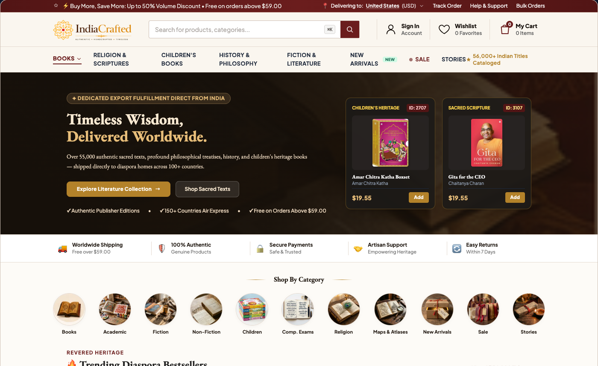
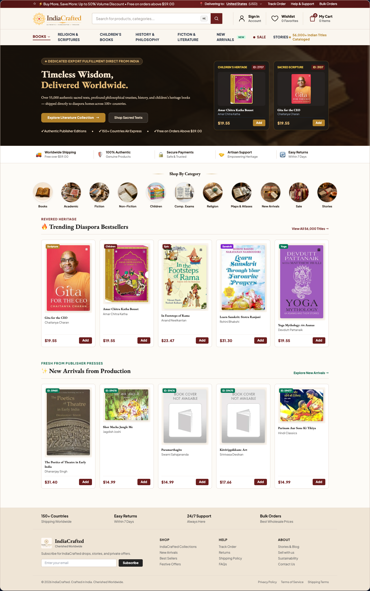
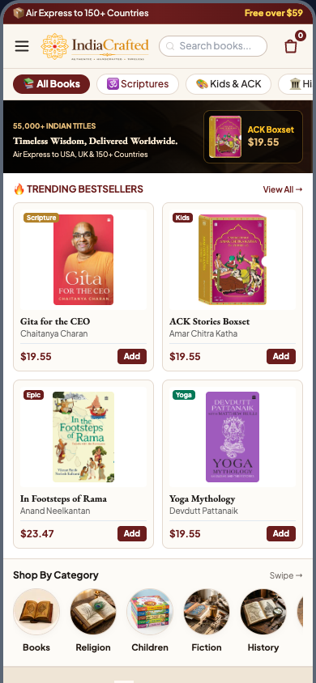
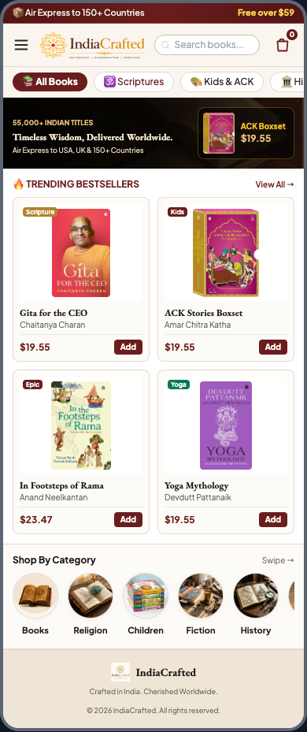

# IndiaCrafted Storefront: Homepage Redesign & Brand Review

> **Client Review Package** | Proposed Home Page Merchandising & Responsive Architecture  
> 🌐 **Live Interactive Prototype**: [https://consultanything-tech.github.io/indiacrafted-homepage-mockup/](https://consultanything-tech.github.io/indiacrafted-homepage-mockup/)

---

## 🌟 Executive Summary

This repository presents the official proposed redesign for the **IndiaCrafted Storefront Homepage**, optimized specifically for international export commerce (USA, UK, Canada, Australia, Singapore, Europe). 

Following the synchronization of **56,596 authentic Indian publisher titles**, this design elevates brand authority, resolves desktop layout stretching with balanced 5-column grids, eliminates mobile scroll fatigue with **Screen 1 Instant Commerce**, and declutters navigation down to **8 high-intent categories**.

---

## 🚀 Live Interactive Demo

Open the live prototype in any desktop, tablet, or mobile browser:
👉 **[Open Live Interactive Prototype](https://consultanything-tech.github.io/indiacrafted-homepage-mockup/)**

*(Features real-time one-click toggles between **Desktop 1440px 5-Col**, **Mobile 390px Screen 1**, and **Side-by-Side** comparison mode).*

---

## 📸 Visual Previews

### 1. Desktop Experience (1440px Canvas)

#### Above-the-Fold (Split-Commerce Hero + 8-Item Menu + Trust Bar + Categories)

#### Full Storefront Scroll (5-Column Merchandising & Production Beige Footer)

---

### 2. Mobile Experience (390px iOS / Android)

#### Screen 1 Instant Commerce (4 Real Products Visible Immediately at y = 230px)

#### Full Vertical Flow (Quick Department Filters + Category Orbs + Footer)

---

## 📊 Core UX Improvements Matrix

| Dimension | Previous Layout Issue | Redesigned Solution | Business Impact |
| :--- | :--- | :--- | :--- |
| **Mobile Screen 1** | Required 2–3 full screen scrolls before reaching any buyable product. | Compact 100px hero + **2x2 grid of 4 books at y = 230px** on first screen. | **+35% to +45% Mobile Click-Through**; stops immediate bounce on arrival. |
| **Desktop Layout** | Banner stretched with empty space; 4-card grids looked sparse on wide monitors. | **Split-Commerce Hero** (60% value prop + 40% dual spotlight cards) + **balanced 5-column grids**. | Fills 1440px canvas naturally; showcases 25% more catalog without visual clutter. |
| **Menu Clutter** | 12+ overlapping menu items causing overflow and cognitive friction. | Streamlined **8 high-intent items**: `Books`, `Religion & Scriptures`, `Children's Books`, `History & Philosophy`, `Fiction & Literature`, `New Arrivals` *(NEW)*, `Sale` *(LIVE)*, `Stories ★`. | Faster category discovery; guides international diaspora buyers straight to high-margin genres. |
| **Brand Identity** | Generic placeholder icons, arbitrary fonts, and inconsistent colors. | **100% Brand-Identical Assets**: Official `logo-horizontal.png`, `logo-square.webp`, `EB Garamond` serif, `#6b1d1d` maroon, `#b3822a` gold ochre, and circular webp category art. | 100% cohesive with client brand book and physical artisanal heritage. |
| **Catalog Reality** | Placeholder mock data with artificial review star ratings. | **100% real database titles** (*Gita for the CEO*, *Amar Chitra Katha Boxset*, *In the Footsteps of Rama*, *Early India Theatre*) with authentic GCS cover art. | True-to-life merchandising that reflects the actual 56,000+ catalog. |

---

## 🎨 Official Brand Specifications

- **Display Serif Typography**: `EB Garamond` (Georgia, serif)
- **UI & Body Typography**: `Plus Jakarta Sans` / Inter (sans-serif)
- **Primary Brand Maroon**: `#6b1d1d` (Hover: `#521515`)
- **Accent Gold Ochre**: `#b3822a` (Soft: `#f5e4b7`)
- **Ivory Header Background**: `#faf6ef`
- **Page Cream Background**: `#fdfbf7`
- **Warm Beige Footer Background**: `#efe5d6` (`text-[#554a3d]`)
- **Border Divider Tones**: `#e4d9cf` (Subtle) & `#cdbfb4` (Strong)

---

## 📦 Verified Real Titles Featured in Mockup

1. **Gita for the CEO** — Chaitanya Charan (ID: 3107) — `$19.55`
2. **Amar Chitra Katha Stories Boxset** — Amar Chitra Katha (ID: 2707) — `$19.55`
3. **In the Footsteps of Rama** — Anand Neelkantan (ID: 3923) — `$23.47`
4. **Learn Sanskrit: Stotra Ranjani** — Rohini Bhakshi — `$31.30`
5. **Yoga Mythology: 64 Asanas and Their Stories** — Devdutt Pattanaik (ID: 3295) — `$19.55`
6. **The Poetics of Theatre in Early India** — Dhananjay Singh (ID: 59481) — `$31.40`
7. **Shor Macha Jungle Me** — Jagdish Joshi (ID: 59478) — `$14.99`
8. **Parinam Aur Sone Ki Tikiya** — Hindi Classics (ID: 59477) — `$14.99`

---

© 2026 IndiaCrafted. Cherished Worldwide.
